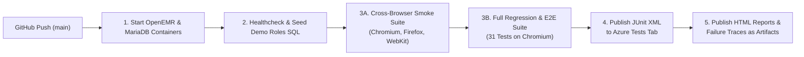
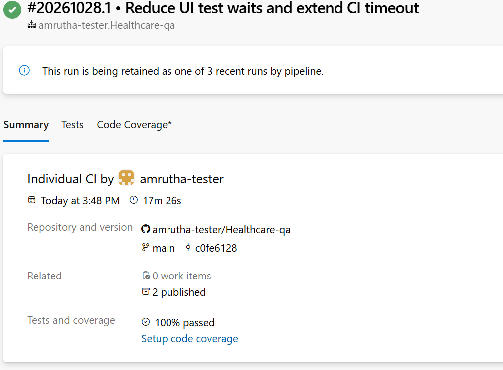
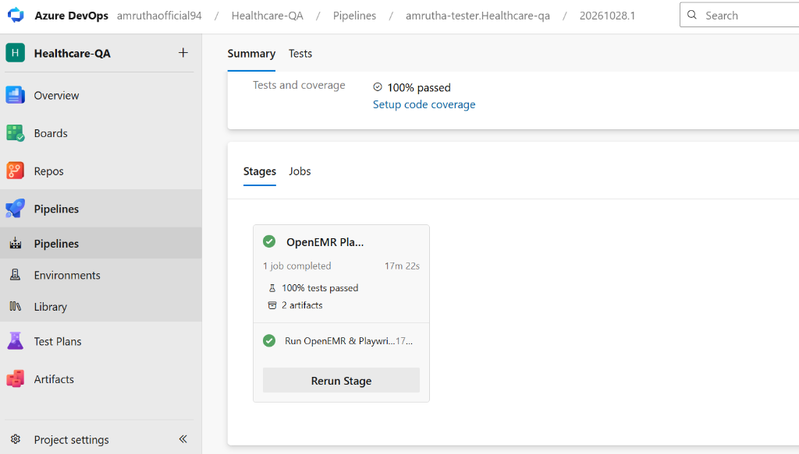
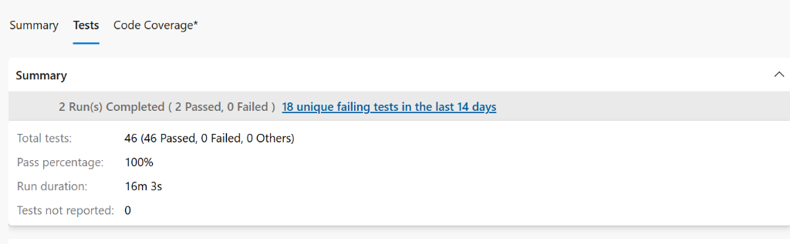

# 🏥 OpenEMR Role-Based Clinical Encounter Automation Framework

[](https://www.python.org/)
[](https://playwright.dev/python/)
[](https://docs.pytest.org/)
[](https://www.docker.com/)
[](https://azure.microsoft.com/en-us/products/devops/pipelines)
[]()
[-purple.svg)]()

A modern, containerized end-to-end UI test automation framework for **OpenEMR** built with **Python**, **Playwright**, **pytest**, **Docker Compose**, and **Azure DevOps Pipelines**.

This framework simulates real-world clinical workflows and validates Role-Based Access Control (RBAC) across multiple healthcare personas—from front-desk patient registration and appointment scheduling to clinical triage, vitals & allergy documentation, physician SOAP notes with electronic signatures (e-Sign), prescriptions, CPT/ICD billing codes, and visit checkout.

---

## 📌 Table of Contents

- [Overview](#-overview)
- [Key Features](#-key-features)
- [Architecture & Tech Stack](#-architecture--tech-stack)
- [Test Coverage Matrix](#-test-coverage-matrix)
- [Project Structure](#-project-structure)
- [User Roles & Permissions](#-user-roles--permissions)
- [CI/CD Pipeline (Azure DevOps & Docker)](#-cicd-pipeline-azure-devops--docker)
- [Pipeline & Test Execution Results](#-pipeline--test-execution-results)
- [Getting Started](#-getting-started)
  - [Prerequisites](#prerequisites)
  - [Local Installation](#local-installation)
  - [Docker OpenEMR Setup & Database Seeding](#docker-openemr-setup--database-seeding)
  - [Environment Configuration](#environment-configuration)
- [Running Tests](#-running-tests)
- [Debugging & Traces](#-debugging--traces)
- [Completed Milestones](#-completed-milestones)

---

## 🔍 Overview

**OpenEMR** is an open-source Electronic Health Record (EHR) and medical practice management application. Automating healthcare EHR systems presents unique engineering challenges: deeply nested multi-iframe layouts (`pat`, `cal`, `flb`, `enc`, `modalframe`), asynchronous Bootstrap modal transitions, strict role-based permissions, and stateful clinical workflows where downstream tests depend on upstream patient states.

This framework solves these challenges by combining:
- **Playwright's auto-waiting engine** with custom iframe/modal synchronization handlers
- **Composable pytest fixture chains** (`registered_patient` ➡️ `checked_in_patient` ➡️ `checked_in_patient_with_vitals` ➡️ `patient_with_soap_note`)
- **Automated database state hygiene** via SQL seeding & truncation before and after every test run
- **Containerized multi-browser execution** orchestrated through **Docker Compose** and **Azure DevOps CI/CD**

---

## 🚀 Key Features

- **🎭 Page Object Model (POM)**: Clean separation of multi-iframe locators, page actions, and test assertions across `LoginPage`, `PatientRegistrationPage`, `AppointmentPage`, `ClinicianPage`, `PhysicianPage`, and `DashboardPage`.
- **🔐 Role-Based Access Control (RBAC)**: Dedicated browser context fixtures and pre-seeded GACL roles for **Receptionist**, **Clinician**, **Physician**, **Accountant**, and **Administrator**.
- **🌐 Multi-Browser Testing**: Cross-browser verification across **Chromium** (Google Chrome / Edge), **Firefox**, and **WebKit** (Apple Safari).
- **🔗 Chained Clinical Workflow Fixtures**: Modular pytest fixtures that progressively build clinical state (registered patient → scheduled & checked-in appointment → recorded vitals → signed SOAP note).
- **🎲 Synthetic HIPAA-Safe Test Data**: Built-in `Faker` data factories (`PatientDataFactory`, `AppointmentDataFactory`, `VitalsDataFactory`, `SoapNoteDataFactory`) generating unique patient demographics and clinical inputs per run.
- **🧹 Self-Cleaning Database State**: Automatic `autouse` session fixture and CI SQL scripts that reset clinical tables (`patient_data`, `openemr_postcalendar_events`, `form_encounter`, `forms`, `esign_signatures`, `patient_tracker`) before and after every run.
- **🐳 Fully Containerized Stack**: `docker-compose.yml` spins up MariaDB 11.4, OpenEMR, and the Playwright test runner container in an isolated network.
- **🔄 Azure DevOps CI/CD Pipeline**: Automated two-stage test execution (Cross-Browser Smoke Suite + Full Chromium Regression & E2E Suite) with JUnit XML test analytics and self-contained HTML report artifacts.

---

## 🛠️ Architecture & Tech Stack

| Component | Technology | Purpose |
| :--- | :--- | :--- |
| **Language** | Python 3.10+ | Core test automation language |
| **Browser Engine** | Playwright (`chromium`, `firefox`, `webkit`) | Cross-browser UI automation & iframe handling |
| **Test Runner** | pytest | Test discovery, fixture dependency injection & markers |
| **Data Generation** | Faker | Dynamic synthetic patient & clinical data factories |
| **Configuration** | Pydantic Settings / `python-dotenv` | Type-safe environment & timeout configuration |
| **Containerization** | Docker & Docker Compose | Containerized OpenEMR, MariaDB 11.4 & Playwright runner |
| **CI/CD Orchestration** | Azure DevOps Pipelines | Automated build, multi-browser execution & artifact publishing |
| **Reporting** | `pytest-html` & JUnit XML | Self-contained HTML reports & Azure DevOps Test tab analytics |

---

## ✅ Test Coverage Matrix

### 1. Functional & Role-Specific Test Modules (`tests/test_01` – `test_18`)

| Test File | Marker | Role | Clinical / Functional Scenario Validated |
| :--- | :--- | :--- | :--- |
| `test_01_smoke.py` | `smoke` | System | OpenEMR server reachability & login page readiness across Chromium, Firefox & WebKit |
| `test_02_role_based_login.py` | `smoke` | All Roles | Valid login for Admin, Physician, Clinician, Receptionist + invalid credential rejection |
| `test_03_rec_register_patient.py` | `regression` | Receptionist | New patient registration + mandatory field validation (`first_name`, `last_name`) |
| `test_04_rec_duplicate_patient.py` | `regression` | Receptionist | Duplicate patient detection modal warning when registering identical demographics |
| `test_05_rec_search_patient.py` | `regression` | Receptionist | Patient lookup by public PID and demographic verification |
| `test_06_rec_new_appointment.py` | `regression` | Receptionist | Scheduling a new provider calendar appointment for a registered patient |
| `test_07_rec_double_booking.py` | `regression` | Receptionist | Provider schedule conflict detection on overlapping appointment time slots |
| `test_08_rec_reschedule_cancel_apt.py` | `regression` | Receptionist | Rescheduling appointment times and canceling/deleting existing appointments |
| `test_09_rec_check_in_patient.py` | `regression` | Receptionist | Patient check-in (`Arrived @` status), room assignment, and Flow Board verification |
| `test_10_clin_select_checkedin_patient.py` | `regression` | Clinician | Filtering Flow Board by provider/patient and opening the checked-in patient chart |
| `test_11_clin_record_vitals.py` | `regression` | Clinician | Recording metric/US vitals, automatic BMI calculation, invalid input & abnormal vitals flags |
| `test_12_clin_add_allergy.py` | `regression` | Clinician | Documenting patient drug allergies (`penicillin`) & severity (`Mild`) on the Dashboard |
| `test_13_clin_status_advance.py` | `regression` | Clinician | Advancing patient Flow Board status during clinical intake |
| `test_14_phy_enter_soapnote.py` | `regression` | Physician | Creating a complete SOAP note (Subjective, Objective, Assessment, Plan) & e-Signing (`Locked`) |
| `test_15_phy_partial_soapnote.py` | `regression` | Physician | Saving & electronically signing a partial SOAP note |
| `test_16_phy_esign_validation.py` | `regression` | Physician | Verifying e-Signature rejection when an invalid physician password is entered |
| `test_17_phy_add_prescription.py` | `regression` | Physician | Prescribing medication (`amoxicillin 500mg`) and verifying Dashboard Rx listing |
| `test_18_phy_add_fee_sheet_code.py` | `regression` | Physician | Adding CPT4 (`99201`) billing codes to the encounter Fee Sheet |

### 2. End-to-End Multi-Role Clinical Workflows (`tests/workflows/`)

| Workflow File | Marker | Personas Involved | End-to-End Journey |
| :--- | :--- | :--- | :--- |
| `test_01_receptionist_workflow.py` | `workflow` | Receptionist | Register new patient ➡️ Schedule appointment ➡️ Check in patient ➡️ Verify `Arrived` on Flow Board |
| `test_02_clinician_workflow.py` | `workflow` | Clinician | Select checked-in patient ➡️ Record vitals & verify BMI ➡️ Add allergy ➡️ Advance status |
| `test_03_physician_workflow.py` | `workflow` | Physician | Open patient from Flow Board ➡️ Enter & e-Sign SOAP note ➡️ Add Prescription ➡️ Add CPT4 Fee Sheet code ➡️ Complete visit (`$`) |
| `test_04_e2e_workflow.py` | `workflow` | Receptionist + Clinician + Physician | **Full Hospital Visit Lifecycle**: Multi-context handoff from Front Desk Registration & Check-In ➡️ Nursing Triage (Vitals + Allergy) ➡️ Physician Consultation (SOAP + e-Sign + Rx + Billing + Checkout) |

---

## 📁 Project Structure

```text
Healthcare-qa/
├── docker/
│   └── seed_demo_users.sql               # Seeds GACL roles, bcrypt passwords & resets clinical test tables
├── src/
│   ├── config/
│   │   ├── roles.py                      # Role credentials & persona metadata
│   │   └── settings.py                   # Pydantic environment settings (BASE_URL, HEADLESS, TIMEOUT)
│   ├── pages/
│   │   ├── base_page.py                  # Core Playwright page wrapper
│   │   ├── login_page.py                 # Login & language selection page object
│   │   ├── patient_registration_page.py  # Demographics registration, duplicate modal & search
│   │   ├── appointment_page.py           # Calendar scheduling, check-in, reschedule & cancellation
│   │   ├── clinician_page.py             # Flow Board selection, encounter vitals & status updates
│   │   ├── physician_page.py             # SOAP note documentation, e-Sign & Fee Sheet billing
│   │   ├── dashboard_page.py             # Patient Dashboard allergies & prescriptions management
│   │   └── components/
│   │       └── base_components.py        # Top navigation & sidebar menu component
│   └── utils/
│       └── data_generator.py             # Faker factories for Patients, Appointments, Vitals & SOAP notes
├── tests/
│   ├── test_01_smoke.py                  # Environment connectivity smoke test
│   ├── test_02_role_based_login.py       # Multi-role RBAC login & negative login tests
│   ├── test_03_rec_register_patient.py   # Patient registration & mandatory field tests
│   ├── test_04_rec_duplicate_patient.py  # Duplicate patient warning test
│   ├── test_05_rec_search_patient.py     # Patient search by PID test
│   ├── test_06_rec_new_appointment.py    # New appointment creation test
│   ├── test_07_rec_double_booking.py     # Provider double-booking conflict test
│   ├── test_08_rec_reschedule_cancel_apt.py # Appointment reschedule & cancellation tests
│   ├── test_09_rec_check_in_patient.py   # Patient check-in & Flow Board verification test
│   ├── test_10_clin_select_checkedin_patient.py # Clinician Flow Board patient selection test
│   ├── test_11_clin_record_vitals.py     # Vitals recording, invalid input & abnormal vitals tests
│   ├── test_12_clin_add_allergy.py       # Patient allergy documentation test
│   ├── test_13_clin_status_advance.py    # Clinician Flow Board status progression test
│   ├── test_14_phy_enter_soapnote.py     # Physician SOAP note & e-Sign test
│   ├── test_15_phy_partial_soapnote.py   # Partial SOAP note e-Sign test
│   ├── test_16_phy_esign_validation.py   # Invalid e-Sign password validation test
│   ├── test_17_phy_add_prescription.py   # Physician prescription creation test
│   ├── test_18_phy_add_fee_sheet_code.py # Physician CPT4 Fee Sheet coding test
│   └── workflows/
│       ├── test_01_receptionist_workflow.py # Front-desk end-to-end workflow
│       ├── test_02_clinician_workflow.py    # Nursing triage end-to-end workflow
│       ├── test_03_physician_workflow.py    # Physician encounter end-to-end workflow
│       └── test_04_e2e_workflow.py          # Complete 3-role hospital visit E2E workflow
├── azure-pipelines.yml                   # Azure DevOps CI/CD pipeline definition
├── conftest.py                           # Session DB cleanup, role contexts & chained state fixtures
├── docker-compose.yml                    # Multi-container orchestration (MariaDB + OpenEMR + Playwright)
├── Dockerfile                            # Playwright Python v1.48 container with Chromium, Firefox & WebKit
├── pytest.ini                            # Pytest configuration & test markers
├── requirements.txt                      # Python package dependencies
└── README.md                             # Project documentation
```

---

## 👥 User Roles & Permissions

The framework seeds and validates five standard healthcare personas in OpenEMR:

| Role | Username | Password | GACL Group | Capabilities / Workflow Area |
| :--- | :--- | :--- | :--- | :--- |
| **Receptionist** | `receptionist` | `receptionist` | Front Office | Patient Registration, Search, Calendar Scheduling, Check-In |
| **Clinician** | `clinician` | `clinician` | Clinicians | Flow Board Triage, Vitals Capture, Allergy Entry, Rooming |
| **Physician** | `physician` | `physician` | Physicians | Clinical Encounters, SOAP Notes, e-Sign, Prescriptions, Fee Sheet |
| **Accountant** | `accountant` | `accountant` | Accounting | Billing Review, Copays, Fee Sheet Auditing |
| **Administrator** | `admin` | `pass` | Administrators | Full system administration, ACL management, facility configuration |

---

## 🔄 CI/CD Pipeline (Azure DevOps & Docker)

Every push to `main` triggers the **Azure DevOps Pipeline** (`azure-pipelines.yml`) running on a Self-Hosted Agent with Docker Compose:



### Pipeline Stages Breakdown:
1. **Start OpenEMR Docker Stack**: Launches `mariadb:11.4` and `openemr/openemr:latest` via `docker compose up -d`.
2. **Wait for OpenEMR & Seed Demo Roles**: Polls `http://localhost:8080` until Apache is ready, then executes `docker/seed_demo_users.sql` to configure demo users, disable first-login telemetry/birthday popups, and clear old test records.
3. **3A — Cross-Browser Smoke Tests**: Builds the `playwright-tests` container and executes `-m smoke` across **Chromium, Firefox, and WebKit** (`15/15 passed`).
4. **3B — Full Regression & E2E Suite**: Resets the database and runs all **31 tests** (Smoke + Regression + 4 Role Workflows) in headless Chromium.
5. **Publish Test Results & HTML Artifacts**: Uploads `junit-smoke-crossbrowser.xml` and `junit-regression.xml` to the Azure DevOps **Tests** tab and publishes `report-smoke-crossbrowser.html` and `report-regression.html` as downloadable pipeline artifacts.

---

## 📊 Pipeline & Test Execution Results

### 1. Azure DevOps CI/CD Pipeline Run Summary (`17m 26s` • `100% Passed`)


### 2. Pipeline Stage & Artifact Verification


### 3. Azure DevOps Test Analytics (`46/46 Passed` • `100% Pass Rate`)


---

## 🏁 Getting Started

### Prerequisites

- **Python 3.10+**
- **Docker Desktop** (for running OpenEMR & containerized tests)
- **Git**

### Local Installation

1. **Clone the repository**:
   ```bash
   git clone https://github.com/amrutha-tester/Healthcare-qa.git
   cd Healthcare-qa
   ```

2. **Create and activate a virtual environment**:
   ```powershell
   python -m venv .venv
   .venv\Scripts\Activate.ps1
   ```

3. **Install dependencies & Playwright browsers**:
   ```powershell
   pip install -r requirements.txt
   playwright install chromium firefox webkit
   ```

### Docker OpenEMR Setup & Database Seeding

1. **Start OpenEMR and MariaDB**:
   ```powershell
   docker compose up -d mysql openemr
   ```

2. **Seed the demo roles and clean clinical tables**:
   ```powershell
   Get-Content docker\seed_demo_users.sql | docker exec -i healthcare-qa-openemr-1 mariadb --skip-ssl -u openemr --password=openemr -h mysql openemr
   ```
   *(Note: When running `pytest` locally, `conftest.py` also executes this database cleanup automatically before and after every test session!)*

### Environment Configuration

Create a `.env` file in the project root (or rely on defaults in `src/config/settings.py`):

```ini
BASE_URL="http://localhost:8080"
DEFAULT_TIMEOUT=20000.0
HEADLESS=false
SLOW_MO=0.5
```

---

## 🧪 Running Tests

### Run Locally with Pytest

```powershell
# Run the entire test suite (Smoke + Regression + Workflows)
pytest

# Run smoke tests across all 3 browsers (Chromium, Firefox, WebKit)
pytest -m smoke --browser=chromium --browser=firefox --browser=webkit

# Run only the regression suite
pytest -m regression

# Run only the end-to-end clinical workflows
pytest -m workflow

# Generate a self-contained HTML report
pytest --html=reports/report-regression.html --self-contained-html
```

### Run Inside Docker Compose

```powershell
# Run Cross-Browser Smoke Tests in Docker
docker compose --profile test run --rm --build playwright-tests pytest -m smoke -o "addopts=-v --browser=chromium --browser=firefox --browser=webkit"

# Run Full Regression & Workflow Suite in Docker
docker compose --profile test run --rm playwright-tests pytest -o "addopts=-v --browser=chromium"
```

---

## 🔍 Debugging & Traces

Playwright automatically captures diagnostic artifacts whenever a test fails:
- **Screenshots**: Saved on failure (`--screenshot=only-on-failure`)
- **Videos**: Retained on failure (`--video=retain-on-failure`)
- **Playwright Trace Viewer**: Inspect step-by-step DOM snapshots, console logs, and network requests:
  ```powershell
  playwright show-trace test-results/<test-folder>/trace.zip
  ```

---

## 🗺️ Completed Milestones

- [x] Page Object Model (POM) architecture with multi-iframe & modal handling
- [x] Role-based authentication fixtures (`receptionist_page`, `clinician_page`, `physician_page`, `admin_page`)
- [x] Synthetic clinical data factories (`PatientDataFactory`, `AppointmentDataFactory`, `VitalsDataFactory`, `SoapNoteDataFactory`)
- [x] Patient Registration, Duplicate Detection & PID Search test suites
- [x] Appointment Scheduling, Double-Booking Conflict, Reschedule & Cancellation tests
- [x] Patient Check-In & Flow Board status progression (`Arrived @` ➡️ `In Exam Room` ➡️ `Completed $`)
- [x] Clinical Vitals intake, BMI calculation, invalid input & abnormal vitals validation
- [x] Patient Allergy & Prescription documentation on the Patient Dashboard
- [x] Physician SOAP Encounter documentation, e-Signature (`Locked`) verification & CPT4 Fee Sheet coding
- [x] Multi-role End-to-End clinical workflow suite (`test_01` through `test_04_e2e_workflow`)
- [x] Docker & Docker Compose containerization with automated MariaDB seeding & cleanup
- [x] Azure DevOps CI/CD Pipeline with Multi-Browser (`Chromium`, `Firefox`, `WebKit`) execution & HTML/JUnit reporting

---

## 📄 License

This project is licensed under the [MIT License](LICENSE).
